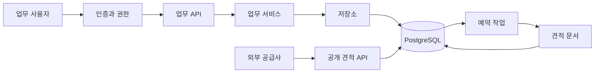

# 구조와 업무 규칙

## 업무 모듈

| 패키지 | 책임 |
|---|---|
| `identity`, `security` | 로그인, 토큰 발급·폐기, 현재 사용자, 역할 검사 |
| `organization` | 현재 조직과 구성원 |
| `catalog` | 조직별 재고·품목 조회 |
| `supplier` | 거래처 등록·조회·CSV 내보내기 |
| `purchase` | 구매 요청, 생성자·승인자 분리, 상태 전환 |
| `invoice` | 청구서 조회와 정산 처리 |
| `document` | 문서 목록, 상세, 텍스트 미리보기 |
| `reporting` | 보고서 정의 저장, 미리보기와 CSV 집계 |
| `portal` | 공개 입찰 공고, 공급사 견적 접수, 접수증 |
| `worker` | 저장된 견적의 문서 생성, 표시 프로필 적용 |
| `audit`, `operations` | 업무 이력, 지원 정보, 대시보드, 상태 확인 |
| `bootstrap`, `common` | 합성 데이터, JSON·CSV 처리, 예외 응답 |

## 권한 계약

| 기능 | READER | ANALYST | BUYER | MANAGER |
|---|---|---|---|---|
| 소속 조직 기본 조회 | 가능 | 가능 | 가능 | 가능 |
| 거래처 등록 | — | 가능 | 가능 | 가능 |
| 구매 요청 생성 | — | — | 가능 | 가능 |
| 구매 승인 | — | — | — | 가능, 본인 생성 건 제외 |
| 청구서 정산 | — | — | — | 가능 |
| 보고서 생성·내보내기 | — | 가능 | — | 가능 |
| 접수 견적 목록 | — | — | 가능 | 가능 |
| 감사 로그·지원 번들 | — | — | — | 가능 |

공개 입찰 조회와 견적 접수는 로그인 없이 사용합니다. 접수증 URL의 UUID는 해당 접수증을 조회하는 capability이며 개인 연락처는 반환하지 않습니다. 공개 포털에서 다른 조직의 내부 자원에 접근하는 권한을 부여하지 않습니다.

## 주요 불변 조건

1. 인증 주체의 조직은 서버가 조회한 사용자 레코드에서 결정합니다.
2. 업무 자원의 접근 범위는 현재 사용자의 조직입니다. 조직 관리자도 이 범위를 벗어나지 않습니다.
3. 발주는 `SUBMITTED → APPROVED`로 전환하며, 생성자가 자신의 발주를 승인할 수 없습니다.
4. 청구서는 `ISSUED → RECONCILED`로 정산합니다.
5. 견적은 `PENDING → PROCESSING → READY/FAILED`로 전환합니다. 약 2초 주기로 한 번에 최대 10건을 처리합니다.
6. 기본 보고서의 차원은 `department`, `status`입니다. 합계는 청구서의 `total`을 집계합니다.

## 데이터와 배포

Flyway V1은 조직·권한·구매 데이터를, V2는 보고서·견적 데이터를 생성하며 V3은 표시 템플릿 문법을 정규화합니다. `DemoData`는 빈 DB에만 데이터를 삽입합니다. 토큰은 난수 원문 대신 SHA-256 해시로 DB에 저장하고, 비밀번호는 BCrypt로 저장합니다.

업무 앱의 DB 역할은 superuser가 아니며 서버 파일 읽기·프로그램 실행 권한을 따로 부여하지 않습니다. 실습 편의를 위해 Flyway와 업무 쿼리에 동일한 DB 역할을 사용합니다. Docker 앱은 일반 사용자로 실행되며 읽기 전용 루트 파일시스템과 크기가 제한된 `/tmp`를 사용합니다. Compose의 `internal` bridge 네트워크는 컨테이너의 외부 통신을 차단하고, 공개 포트도 host loopback에만 바인딩합니다.

실습 범위는 단일 앱 인스턴스입니다. 작업 실행 중 강제 종료된 `PROCESSING` 레코드 재시도, 무한 데이터 보존 방지, 다중 인스턴스 운영, 메일 발송, 실결제, 배포용 비밀 관리 등은 구현 범위 밖입니다.
